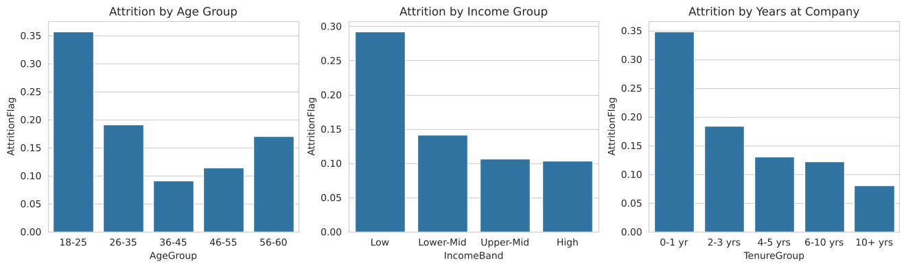
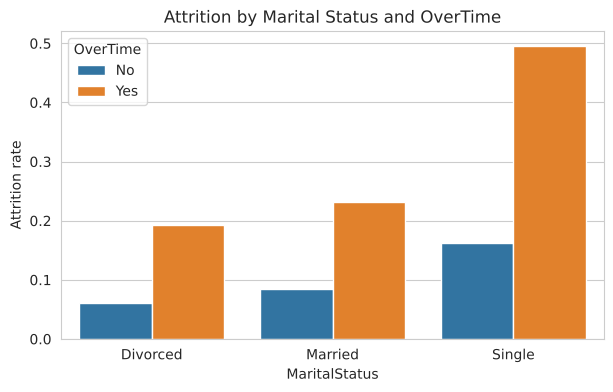

# IBM HR Employee Attrition Analysis

A beginner-friendly data analysis project that finds **why employees leave** and gives **recommendations to HR**.

**Tools:** Python, pandas, NumPy, Matplotlib, Seaborn, Jupyter Notebook

Notebook: [IBM_Attrition_Analysis.ipynb](IBM_Attrition_Analysis.ipynb) (charts and outputs are already shown)

## Objective
HR wants to know the reasons behind employee attrition and asked the data analyst for solutions and recommendations.

## Dataset
IBM HR Analytics Employee Attrition dataset: 1,470 employees and 35 columns. The target column is `Attrition` (Yes / No).

## Steps
1. **Data profiling:** shape, data types, summary statistics
2. **Data cleaning:** duplicates, missing values, extra spaces, data types, removing unneeded columns, creating new columns (`AgeGroup`, `IncomeBand`, `TenureGroup`, `AttritionFlag`)
3. **EDA:** univariate, bivariate and multivariate analysis with 9 charts
4. **Insights and recommendations**

## Key Findings
- Overall attrition is **16.1%** (237 of 1,470 employees)
- **Overtime** is the biggest driver: 30.5% attrition with overtime vs 10.4% without
- **Single employees working overtime** leave at about 50%
- **Sales Representatives** have the highest attrition (about 40%)
- **Age 18-25** (about 36%) and **first-year employees** (about 35%) leave the most
- **Low-income employees** leave more (about 29%)





## Recommendations for HR
1. Reduce overtime, especially in Sales and Lab roles
2. Support new employees in their first year with onboarding and a mentor
3. Review salaries for low-income employees and Sales Representatives
4. Create career growth plans for young employees
5. Collect regular feedback and act on low satisfaction scores

*These are patterns in the data and do not prove the cause.*

## Project Structure
```
├── IBM_Attrition_Analysis.ipynb
├── data/
│   ├── IBM_HR_Attrition.xlsx
│   └── IBM_attrition_cleaned.csv
├── images/
├── requirements.txt
└── README.md
```

## How to Run
```
pip install -r requirements.txt
jupyter notebook IBM_Attrition_Analysis.ipynb
```

## Notes
Built with AI assistance (Claude); edit this line to describe how you used it.

## Author
Your Name | [LinkedIn](https://linkedin.com/in/your-profile) | [GitHub](https://github.com/your-username)
