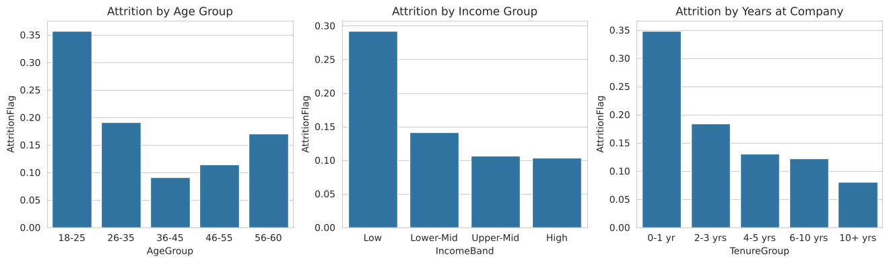
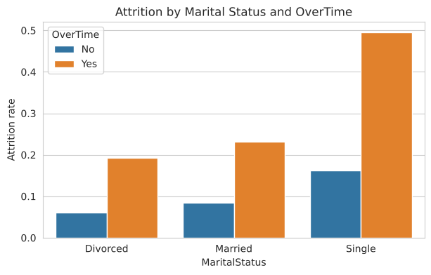

# 👥 IBM HR Employee Attrition Analysis

An exploratory data analysis (EDA) project that finds **why employees leave** and gives HR **data-backed recommendations** to reduce attrition.

**Tools:** Python · pandas · NumPy · Matplotlib · Seaborn · Jupyter Notebook

📓 **[Open the notebook](IBM_attrition_Analysis/IBM_Attrition_Analysis.ipynb)** (all charts and outputs are already rendered)

---

## 🎯 Objective
HR wants to understand the reasons behind employee attrition and asks the data analyst for solutions and recommendations.

## 📊 Dataset
IBM HR Analytics Employee Attrition dataset: **1,470 employees × 35 columns** (age, income, job role, overtime, satisfaction ratings, tenure, etc.). The target column is `Attrition` (Yes / No).

## 🧹 What I did
1. **Data profiling:** shape, data types, summary statistics, constant columns
2. **Data cleaning:** numeric codes to text, duplicates, missing values, typos and spaces, correct data types, removed unneeded columns
3. **Feature engineering:** `AgeGroup`, `IncomeBand`, `TenureGroup`, `DistanceGroup`, `PromotionGap`, `AttritionFlag`
4. **EDA:** univariate, bivariate and multivariate analysis with 19 visualizations

## 🔍 Key Findings
- Overall attrition is **16.1%** (237 of 1,470 employees)
- **Overtime** is the strongest driver: **30.5%** attrition vs 10.4% without overtime
- **Single employees working overtime** leave at about **50%**
- **Sales Representatives** have the highest attrition (about **40%**)
- **Age 18-25** (about 36%) and **first-year employees** (about 35%) are most likely to leave
- **Low income**, **no stock options**, **frequent travel** and **bad work-life balance** all show higher attrition





## ✅ Recommendations
| Priority | Action |
|---|---|
| High | Reduce and cap overtime, especially in Sales, Lab and junior roles |
| High | Improve first-year onboarding with mentoring and regular check-ins |
| Medium | Review pay for the lowest income band and Sales Representatives; offer stock options to junior staff |
| Medium | Create clear career paths for employees under 26 |
| Low | Limit frequent travel; offer hybrid or remote options for long commutes |
| Low | Run regular satisfaction and work-life-balance surveys |

> These are patterns in the data and show association, not proof of cause.

## 📁 Project Structure
```
├── IBM_Attrition_Analysis.ipynb   # full analysis
├── data/
│   ├── IBM_HR_Attrition.xlsx      # raw data
│   └── IBM_attrition_cleaned.csv  # cleaned data
├── images/                        # charts used in this README
├── requirements.txt
└── README.md
```

## ▶️ How to Run
```bash
pip install -r requirements.txt
jupyter notebook IBM_Attrition_Analysis.ipynb
```


## 👤 Author
**Neeraj Chauhan** · [LinkedIn](https://www.linkedin.com/in/neeraj-chauhan-419580361/) · [GitHub](https://github.com/neerajchauhan07)
